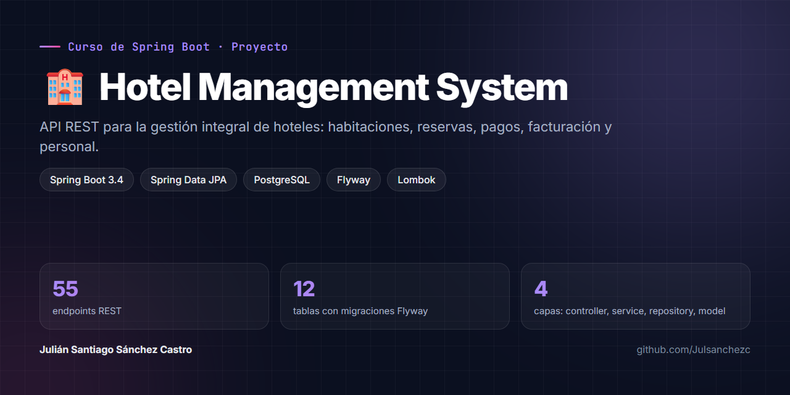

<p align="center">
  
</p>

<p align="center">
  
  
  
  
</p>

# 🏨 Hotel Management System

API REST desarrollada con **Spring Boot** y **PostgreSQL** para la administración integral de hoteles: usuarios y roles, habitaciones, reservas, pagos, facturación, servicios adicionales y personal.

Proyecto del curso de **Spring Boot**.

## ✨ Lo más destacado

- 🌐 **55 endpoints REST** (CRUD completo sobre 11 entidades).
- 🧱 **Arquitectura en capas**: `controller` → `service` → `repository` → `model`.
- 🗄️ **12 tablas en PostgreSQL** con relaciones 1:1, 1:N y N:M.
- 🔁 **Migraciones versionadas con Flyway**; Hibernate solo valida el esquema (`ddl-auto=validate`).
- 🔐 **Credenciales por variables de entorno**, sin contraseñas en el repositorio.

## 👥 Equipo

- Omar Daniel Calvache Madroñero
- **Julián Santiago Sánchez Castro**
- Kelly Yhojanna Marin

---

## 🛠️ Tecnologías Utilizadas

- Java 17
- Spring Boot 3.4.5
- Spring Data JPA / Hibernate
- PostgreSQL
- Flyway (migraciones automáticas)
- Lombok
- Maven

---

## 📁 Estructura del Proyecto

```
src/
├── main/
│   ├── java/com/hotel/gestion_hotelera/
│   │   ├── GestionHoteleraApplication.java
│   │   ├── exception/
│   │   │   ├── ResourceNotFoundException.java
│   │   │   └── GlobalExceptionHandler.java
│   │   ├── controller/
│   │   │   ├── UsuarioController.java
│   │   │   ├── RolController.java
│   │   │   ├── HotelController.java
│   │   │   ├── HabitacionController.java
│   │   │   ├── ClienteController.java
│   │   │   ├── ReservaController.java
│   │   │   ├── PagoController.java
│   │   │   ├── FacturaController.java
│   │   │   ├── ServicioController.java
│   │   │   ├── EmpleadoController.java
│   │   │   └── AdministradorController.java
│   │   ├── model/
│   │   │   ├── Rol.java
│   │   │   ├── Usuario.java
│   │   │   ├── Hotel.java
│   │   │   ├── Habitacion.java
│   │   │   ├── Reserva.java
│   │   │   ├── Pago.java
│   │   │   ├── Factura.java
│   │   │   ├── Servicio.java
│   │   │   ├── Cliente.java
│   │   │   ├── Empleado.java
│   │   │   └── Administrador.java
│   │   ├── repository/
│   │   │   ├── RolRepository.java
│   │   │   ├── UsuarioRepository.java
│   │   │   ├── HotelRepository.java
│   │   │   ├── HabitacionRepository.java
│   │   │   ├── ReservaRepository.java
│   │   │   ├── PagoRepository.java
│   │   │   ├── FacturaRepository.java
│   │   │   ├── ServicioRepository.java
│   │   │   ├── ClienteRepository.java
│   │   │   ├── EmpleadoRepository.java
│   │   │   └── AdministradorRepository.java
│   │   └── service/
│   │       ├── UsuarioService.java
│   │       ├── RolService.java
│   │       ├── HotelService.java
│   │       ├── HabitacionService.java
│   │       ├── ReservaService.java
│   │       ├── PagoService.java
│   │       ├── FacturaService.java
│   │       ├── ServicioService.java
│   │       ├── ClienteService.java
│   │       ├── EmpleadoService.java
│   │       └── AdministradorService.java
│   └── resources/
│       ├── application.properties
│       └── db/migration/
│           ├── V1__crear_tablas_iniciales.sql
│           └── V2__crear_tablas_cliente_empleado_administrador.sql
```

---

## 🗄️ Modelo Relacional

El sistema cuenta con 12 tablas principales:

| Tabla | Descripción |
|---|---|
| `roles` | Roles del sistema (admin, cliente, empleado) |
| `usuarios` | Usuarios registrados en el sistema |
| `hoteles` | Información de los hoteles |
| `habitaciones` | Habitaciones por hotel |
| `reservas` | Reservas realizadas por usuarios |
| `pagos` | Pagos asociados a reservas |
| `facturas` | Facturas generadas por pago |
| `servicios` | Servicios adicionales disponibles |
| `reserva_servicio` | Relación N:M entre reservas y servicios |
| `clientes` | Clientes del hotel con datos personales |
| `empleados` | Personal del hotel por departamento |
| `administradores` | Administradores vinculados a usuario y hotel |

### Relaciones principales

- `roles` → `usuarios` (1:N)
- `hoteles` → `habitaciones` (1:N)
- `hoteles` → `empleados` (1:N)
- `hoteles` → `administradores` (1:N)
- `usuarios` → `reservas` (1:N)
- `usuarios` → `administradores` (1:1)
- `habitaciones` → `reservas` (1:N)
- `reservas` → `pagos` (1:N)
- `pagos` → `facturas` (1:1)
- `reservas` ↔ `servicios` (N:M)

---

## 🧩 Capa de Servicios

Cada servicio implementa las siguientes operaciones CRUD:

| Método | Descripción |
|---|---|
| `save()` | Guardar un nuevo registro |
| `findAll()` | Listar todos los registros |
| `findById()` | Buscar por ID |
| `update()` | Actualizar un registro existente |
| `delete()` | Eliminar por ID |

### Servicios disponibles

| Servicio | Entidad que gestiona |
|---|---|
| `UsuarioService` | Usuario |
| `RolService` | Rol |
| `HotelService` | Hotel |
| `HabitacionService` | Habitación |
| `ReservaService` | Reserva |
| `PagoService` | Pago |
| `FacturaService` | Factura |
| `ServicioService` | Servicio |
| `ClienteService` | Cliente |
| `EmpleadoService` | Empleado |
| `AdministradorService` | Administrador |

---

## 🌐 Endpoints REST

Todos los endpoints siguen el patrón CRUD estándar. El servidor corre en `http://localhost:8081`.

| Método | Endpoint | Descripción |
|---|---|---|
| GET | `/usuarios` | Listar todos los usuarios |
| GET | `/usuarios/{id}` | Buscar usuario por ID |
| POST | `/usuarios` | Crear usuario |
| PUT | `/usuarios/{id}` | Actualizar usuario |
| DELETE | `/usuarios/{id}` | Eliminar usuario |
| GET | `/roles` | Listar todos los roles |
| GET | `/roles/{id}` | Buscar rol por ID |
| POST | `/roles` | Crear rol |
| PUT | `/roles/{id}` | Actualizar rol |
| DELETE | `/roles/{id}` | Eliminar rol |
| GET | `/hoteles` | Listar todos los hoteles |
| GET | `/hoteles/{id}` | Buscar hotel por ID |
| POST | `/hoteles` | Crear hotel |
| PUT | `/hoteles/{id}` | Actualizar hotel |
| DELETE | `/hoteles/{id}` | Eliminar hotel |
| GET | `/habitaciones` | Listar todas las habitaciones |
| GET | `/habitaciones/{id}` | Buscar habitación por ID |
| POST | `/habitaciones` | Crear habitación |
| PUT | `/habitaciones/{id}` | Actualizar habitación |
| DELETE | `/habitaciones/{id}` | Eliminar habitación |
| GET | `/reservas` | Listar todas las reservas |
| GET | `/reservas/{id}` | Buscar reserva por ID |
| POST | `/reservas` | Crear reserva |
| PUT | `/reservas/{id}` | Actualizar reserva |
| DELETE | `/reservas/{id}` | Eliminar reserva |
| GET | `/pagos` | Listar todos los pagos |
| GET | `/pagos/{id}` | Buscar pago por ID |
| POST | `/pagos` | Crear pago |
| PUT | `/pagos/{id}` | Actualizar pago |
| DELETE | `/pagos/{id}` | Eliminar pago |
| GET | `/facturas` | Listar todas las facturas |
| GET | `/facturas/{id}` | Buscar factura por ID |
| POST | `/facturas` | Crear factura |
| PUT | `/facturas/{id}` | Actualizar factura |
| DELETE | `/facturas/{id}` | Eliminar factura |
| GET | `/servicios` | Listar todos los servicios |
| GET | `/servicios/{id}` | Buscar servicio por ID |
| POST | `/servicios` | Crear servicio |
| PUT | `/servicios/{id}` | Actualizar servicio |
| DELETE | `/servicios/{id}` | Eliminar servicio |
| GET | `/clientes` | Listar todos los clientes |
| GET | `/clientes/{id}` | Buscar cliente por ID |
| POST | `/clientes` | Crear cliente |
| PUT | `/clientes/{id}` | Actualizar cliente |
| DELETE | `/clientes/{id}` | Eliminar cliente |
| GET | `/empleados` | Listar todos los empleados |
| GET | `/empleados/{id}` | Buscar empleado por ID |
| POST | `/empleados` | Crear empleado |
| PUT | `/empleados/{id}` | Actualizar empleado |
| DELETE | `/empleados/{id}` | Eliminar empleado |
| GET | `/administradores` | Listar todos los administradores |
| GET | `/administradores/{id}` | Buscar administrador por ID |
| POST | `/administradores` | Crear administrador |
| PUT | `/administradores/{id}` | Actualizar administrador |
| DELETE | `/administradores/{id}` | Eliminar administrador |

---

## ⚙️ Requisitos Previos

- [Java JDK 17+](https://www.oracle.com/java/technologies/downloads/)
- [PostgreSQL 14+](https://www.postgresql.org/download/)
- [Maven 3.8+](https://maven.apache.org/download.cgi) (o usar el wrapper incluido `./mvnw`)
- [pgAdmin](https://www.pgadmin.org/) (opcional, para visualizar la BD)

---

## 🚀 Instrucciones de Ejecución

### 1. Clonar el repositorio

```bash
git clone https://github.com/Julsanchezc/Hotel-Management-System.git
cd Hotel-Management-System
```

### 2. Crear la base de datos en PostgreSQL

Abre pgAdmin o cualquier cliente SQL y ejecuta:

```sql
CREATE DATABASE gestion_hotelera_db;
```

### 3. Configurar credenciales

Las credenciales se leen de variables de entorno (no hay contraseñas en el repositorio). `DB_USER` es opcional y por defecto es `postgres`:

```powershell
# PowerShell
$env:DB_USER="postgres"
$env:DB_PASSWORD="tu_contraseña"
```

```bash
# Linux / macOS
export DB_USER=postgres
export DB_PASSWORD=tu_contraseña
```

### 4. Correr el proyecto

```bash
./mvnw spring-boot:run
```

O desde IntelliJ: clic derecho en `GestionHoteleraApplication.java` → **Run**.

### 5. Verificar

Flyway ejecutará automáticamente las migraciones y creará las 12 tablas. En la consola deberías ver:

```
Started GestionHoteleraApplication in X.XXX seconds
```

El servidor queda disponible en: `http://localhost:8081`

---

## 🗂️ Migraciones con Flyway

Las migraciones se encuentran en:

```
src/main/resources/db/migration/
```

| Archivo | Descripción |
|---|---|
| `V1__crear_tablas_iniciales.sql` | Tablas base: roles, usuarios, hoteles, habitaciones, reservas, pagos, facturas, servicios |
| `V2__crear_tablas_cliente_empleado_administrador.sql` | Nuevas tablas: clientes, empleados, administradores |

Flyway lleva el historial de migraciones en la tabla `flyway_schema_history` dentro de la base de datos.

---

## 📌 Notas

- El proyecto usa `spring.jpa.hibernate.ddl-auto=validate`, lo que significa que Hibernate **no crea ni modifica tablas** — eso lo maneja exclusivamente Flyway.
- Las credenciales de la base de datos se manejan mediante variables de entorno para evitar exponer contraseñas en el repositorio.
- **Manejo de errores centralizado:** `GlobalExceptionHandler` (`@RestControllerAdvice`) convierte `ResourceNotFoundException` en un **404** con formato estándar *Problem Details* (RFC 9457). Por eso los controladores no necesitan `try/catch`.
- **Códigos HTTP correctos:** `POST` responde **201 Created**, `DELETE` responde **204 No Content**, y buscar, actualizar o eliminar un ID inexistente responde **404 Not Found**.
- **Inyección por constructor** en todos los controladores y servicios: dependencias `final`, más fáciles de probar.
